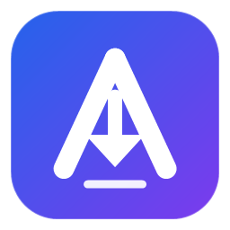

<div align="center">



# 🚀 المدير عبد العزيز
### **Aziz Manager v1.0.0**
#### *برنامج التحميل المتقدم فائق السرعة وخفيف الوزن لنظام Windows*

[](https://github.com/aliwieii/get-aziz/releases/tag/v1.0.0)
[](https://github.com/aliwieii)
[-10B981?style=for-the-badge&logo=windows11&logoColor=white)](https://github.com/aliwieii/get-aziz/releases/tag/v1.0.0)

<br/>

---

### 📥 روابط التحميل المباشرة والسريعة (Direct Downloads)

> 💡 **روابط مباشرة 100% تعمل من أي متصفح (جوال أو كمبيوتر) وبأقصى سرعة اتصال وبدون أي إعلانات:**

| الملف | النوع والحجم | رابط التحميل المباشر |
| :--- | :--- | :---: |
| 📦 **برنامج التثبيت الكامل** | `AzizManager-Setup.exe` (~75 MB) | [**⬇️ تحميل برنامج التثبيت**](https://github.com/aliwieii/get-aziz/releases/download/v1.0.0/AzizManager-Setup.exe) |
| ⚡ **النسخة المحمولة (بدون تثبيت)** | `AzizManager.exe` (~34 MB) | [**⬇️ تحميل النسخة المحمولة**](https://github.com/aliwieii/get-aziz/releases/download/v1.0.0/AzizManager.exe) |
| 🧩 **إضافة المتصفح (Chrome / Edge)** | `AzizManager-Extension.zip` (~43 KB) | [**⬇️ تحميل إضافة المتصفح**](https://github.com/aliwieii/get-aziz/releases/download/v1.0.0/AzizManager-Extension.zip) |

---

</div>

<br/>

## ✨ أبرز مميزات "المدير عبد العزيز"

* 🚀 **أقصى سرعة تحميل (Multi-threaded Acceleration):** تقسيم الملفات إلى مسارات متزامنة متعددة لمضاعفة سرعة التنزيل إلى أقصى طاقة يدعمها اتصالك.
* 🎬 **التقاط وسحب الفيديوهات الذكي:** تحميل الفيديوهات من YouTube و Facebook و Twitter بأعلى دقة ممكنة (حتى 4K و 60fps) واستخراج الصوت كـ MP3 بدمج تلقائي مدمج عبر FFmpeg و yt-dlp.
* 🧩 **إضافة متصفح عصرية:** ملحق خفيف ومتطور لمتصفحات Chrome و Edge و Firefox يضع زراً عائماً فخماً فوق أي فيديو لالتقاطه وتحميله فوراً.
* 🎨 **واجهة Slint بالوضع الداكن الملكي:** تصميم عصري وأنيق مبني بلغة Rust الخارقة ليكون فائق الخفة والسرعة على موارد الجهاز (RAM & CPU).
* 🔄 **استكمال التحميل وجدولة المهام:** استئناف التنزيلات المتقطعة في أي وقت، وتنظيم التحميلات في قوائم وجداول زمنية ذكية.
* 🛡️ **نظيف 100% وخالٍ من الإعلانات:** تطبيق شخصي مستقل بالكامل بدون أي إعلانات أو برمجيات تتبع للحفاظ على خصوصيتك وسرعة جهازك.

<br/>

---

## 🧩 طريقة تثبيت إضافة المتصفح في دقيقة واحدة

1. حمّل ملف الإضافة من الرابط أعلاه: [**AzizManager-Extension.zip**](https://github.com/aliwieii/get-aziz/releases/download/v1.0.0/AzizManager-Extension.zip) وفك الضغط عنه.
2. افتح متصفحك (Google Chrome أو Microsoft Edge) واذهب إلى عنوان الإضافات:
   ```text
   chrome://extensions
   ```
3. فعّل **وضع المطور (Developer mode)** من الزاوية العلوية.
4. اضغط على زر **تحميل ملحق تم فك حزمته (Load unpacked)**، ثم اختر مجلد الإضافة المفكوك.
5. مبروك! ستظهر لك أيقونة **Aziz Manager** في شريط المتصفح وسيتعرف تلقائياً على أي فيديو تشاهده.

<br/>

---

<div align="center">

### 👑 Aziz Manager v1.0 — Presented by aliwieii
*جميع الحقوق محفوظة © 2026*

</div>
